# U-Drive 시스템 전체 기능 설명

> 대상: 이 저장소를 처음 보는 개발자. 기능별 동작, Seafile API 사용 범위, 보안 조치를 정리했다.
> 기준: v0.11.2 (2026-10-31). 코드가 바뀌면 이 문서는 자동으로 따라가지 않는다.

## 목차

1. [한눈에 보기](#1-한눈에-보기)
2. [전체 구조](#2-전체-구조)
3. [로그인과 세션](#3-로그인과-세션)
4. [파일 탐색](#4-파일-탐색)
5. [파일 작업](#5-파일-작업)
6. [업로드](#6-업로드)
7. [다운로드](#7-다운로드)
8. [미리보기](#8-미리보기)
9. [검색](#9-검색)
10. [공유 링크](#10-공유-링크)
11. [휴지통](#11-휴지통)
12. [바로 보내기](#12-바로-보내기)
13. [Claude 연결 (MCP)](#13-claude-연결-mcp)
14. [트레이·창·자동 실행](#14-트레이창자동-실행)
15. [설정](#15-설정)
16. [자동 업데이트](#16-자동-업데이트)
17. [오류 로그](#17-오류-로그)
18. [개발·검사·릴리스](#18-개발검사릴리스)
19. [로컬 저장소 키 정리](#19-로컬-저장소-키-정리)
20. [서버를 거치는가: 기능별 정리](#20-서버를-거치는가-기능별-정리)
21. [기능별 출처: Seafile API vs 자체 개발](#21-기능별-출처-seafile-api-vs-자체-개발)
22. [보안 처리 사항](#22-보안-처리-사항)

---

## 1. 한눈에 보기

U-Drive는 **Seafile 서버에 붙는 Windows·macOS 데스크톱 파일 관리 앱**이다. Seafile 웹 화면 대신 탐색기·Finder처럼 쓰게 만든 클라이언트다.

| 항목 | 내용 |
| --- | --- |
| 앱 틀 | Tauri 2 (Rust 백엔드 + 시스템 WebView) |
| 화면 | React 19 + TypeScript + Vite, Tailwind CSS 4, shadcn(base-ui) 컴포넌트 |
| 데이터 요청 | TanStack Query 5 |
| 서버 | Seafile (기본 주소 `https://uxis.heavybear-lab.net`) |
| 앱 식별자 | `com.chang.seadrive`, 제품 이름 `Drive`, 실행 파일 `seadrive` |
| 배포 | GitHub Releases. Windows `.exe` 설치 파일, macOS universal `.dmg` |

기능 묶음은 다음과 같다.

- **드라이브 기본 기능**: 로그인, 탐색, 업로드·다운로드, 미리보기, 검색, 공유 링크, 휴지통
- **데스크톱 기능**: 트레이 상주, 자동 실행, OS 파일 아이콘, 자동 업데이트, 오류 로그
- **바로 보내기**: 같은 사내 네트워크의 U-Drive끼리 서버를 거치지 않고 파일을 직접 주고받기
- **Claude 연결**: Claude Code·Claude 데스크톱 앱에서 말로 드라이브 파일을 올리고 받기 (MCP)

어떤 기능이 Seafile API를 그대로 쓴 것이고 어떤 기능이 앱에서 따로 만든 것인지는 [21장](#21-기능별-출처-seafile-api-vs-자체-개발)에 정리했다.

---

## 2. 전체 구조

### 2.1 구성 요소

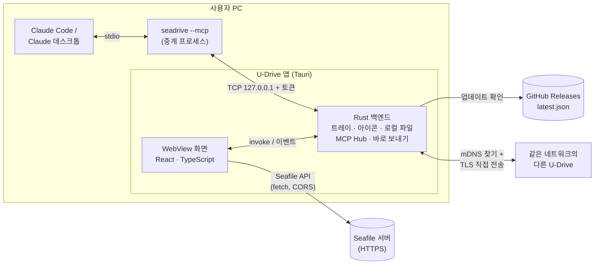

- **화면(WebView)**이 Seafile API를 **직접** 부른다. 그래서 서버에 CORS(Cross-Origin Resource Sharing) 설정이 필요하다 (`docs/nginx-cors.conf`, `docs/traefik-cors.yml`, `docs/dokploy-cors.md`).
- **Rust 쪽**은 브라우저가 못 하는 일을 맡는다. 트레이, OS 파일 아이콘, 로컬 파일 읽기·쓰기, Claude 연결 중계, 바로 보내기 네트워크 통신이 여기에 있다.

### 2.2 저장소 추상화

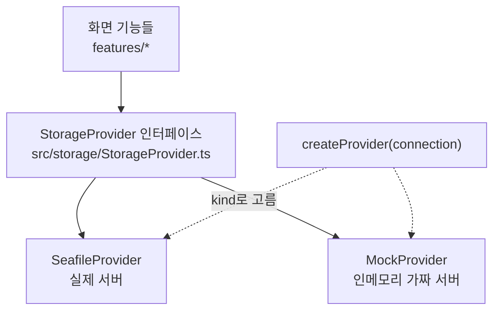

- 화면 코드는 `StorageProvider`만 거친다. Seafile API를 직접 부르면 `npm run lint`가 실패한다.
- 로그인 화면 서버 주소에 `mock`을 넣으면 서버 없이 화면을 확인할 수 있다.
- 인터페이스가 제공하는 기능: 로그인·로그아웃, 계정 정보, 그룹, 저장소 목록·이름 변경·즐겨찾기, 폴더 목록, 저장소 전체 트리, 업로드, 다운로드 URL, 미리보기 URL, 텍스트 읽기, 썸네일, 새 폴더, 이름 변경, 삭제, 이동, 공유 링크 만들기·목록·삭제, 휴지통 목록·복원·비우기.

### 2.3 폴더 구조

```
src/
  storage/            StorageProvider, Seafile·Mock 구현, 세션·기기 정보
  features/
    auth/             로그인 화면
    browse/           메인 화면, 사이드바, 목록·아이콘 보기, 선택·끌어서 옮기기
    upload/ download/ transfer/   전송 큐와 패널
    preview/          미리보기 모달
    search/           통합 검색
    share/            공유 링크 대화상자·관리 페이지
    trash/            휴지통 페이지
    nearby/           바로 보내기 화면
    mcp/              Claude 도구 처리
    settings/         설정 대화상자, 앱 설정 저장
    shell/            메뉴 막대, 제목 표시줄, 상태 표시줄, 업데이트
  components/ui/      공용 UI 컴포넌트
src-tauri/src/
  lib.rs              앱 시작, 트레이, 플러그인, OS 아이콘, 로그
  main.rs             진입점 (--mcp면 중계 모드)
  mcp.rs              Claude 연결 Hub·중계
  nearby.rs           바로 보내기 찾기·전송
  tls.rs              바로 보내기 TLS 인증서
  localfs.rs          로컬 파일 읽기·쓰기 (MCP·바로 보내기용)
claude-plugin/        Claude Code 플러그인, Claude 데스크톱 확장(.mcpb)
docs/                 디자인 규칙(DESIGN.md), 배포·CORS 안내
```

---

## 3. 로그인과 세션

### 3.1 로그인 화면

- **서버 주소**: 기본값이 들어 있다. `https://`만 받는다. 주소만 쓰면 `https://`를 붙인다. `http://`는 비밀번호와 토큰이 평문으로 나가므로 거절한다. 개발용 `mock`과 `http://localhost`·`127.0.0.1`만 예외다.
- **2단계 인증**: 서버가 OTP(One-Time Password)를 요구하면 입력란이 나오고, `X-SEAFILE-OTP` 헤더로 보낸다.
- **아이디 저장**, **자동 로그인** 선택.
- 로그인 화면 아래에 **버전 표시와 업데이트 확인 버튼**이 있다. 새 버전이 있으면 그 자리에서 업데이트할 수 있다.

### 3.2 기기별 토큰

앱에서 로그인하면 Seafile의 **기기별 토큰(TokenV2)**을 받는다.

- 설치마다 한 번 만든 40자 16진수 기기 id, PC 이름, OS, 앱 버전을 함께 보낸다 (`src/storage/device.ts`).
- 사용자는 Seafile 웹의 "연결된 기기"에서 이 PC만 골라 끊을 수 있다.
- 로그아웃하면 `/api2/logout-device/`로 **서버의 토큰도 지운다**.
- 브라우저 개발 화면(`npm run dev`)에서는 기기 정보 없이 예전 방식 토큰을 쓴다.

### 3.3 세션 저장

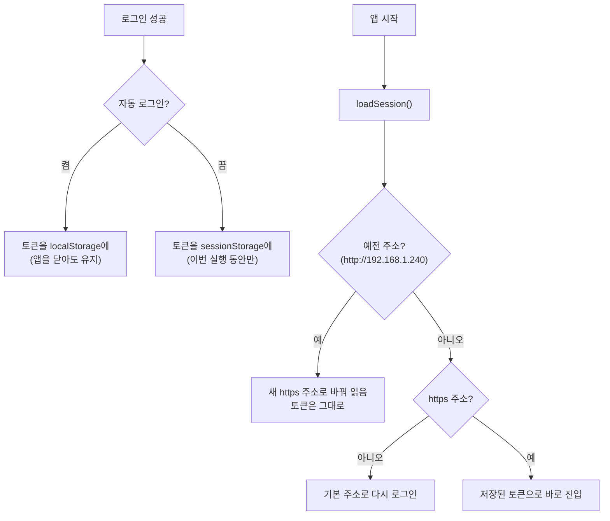

- 서버 주소(연결 정보)는 항상 localStorage에 남는다.
- 요청이 401(인증 만료)을 받으면 로그인 화면으로 돌아간다.

---

## 4. 파일 탐색

### 4.1 화면 구성

```
┌──────────────────────────────────────────────────────────┐
│ 제목 표시줄 · 메뉴 막대(파일·편집·보기·이동·도움말) · 검색 │
├────────────┬─────────────────────────────┬───────────────┤
│ 사이드바    │ 파일 목록 / 아이콘 보기       │ 상세 패널      │
│ 즐겨찾기    │                             │ (선택한 항목)  │
│ 내 저장소   │                             │               │
│ 나에게 공유됨│                             │               │
│ ──────     │                             │               │
│ 바로 보내기 │                             │               │
│ 공유 링크   │                             │               │
│ 휴지통      │                             │               │
├────────────┴─────────────────────────────┴───────────────┤
│ 상태 표시줄 (항목 수, 링크 N개 등) · 전송 패널(우하단)       │
└──────────────────────────────────────────────────────────┘
```

### 4.2 사이드바와 저장소

- 저장소(Seafile의 library)를 **즐겨찾기 / 내 저장소 / 나에게 공유됨**(개인·그룹 공유 모두)으로 나눠 보여 준다.
- 저장소 **즐겨찾기 지정·해제**, **이름 변경**을 할 수 있다.
- **암호화된 저장소**는 자물쇠 아이콘으로 표시하고 열 수 없다(지원하지 않음).
- **읽기 전용으로 공유받은 저장소**는 업로드·새 폴더·이름 변경·삭제가 꺼진다.
- 사이드바 너비를 끌어서 바꿀 수 있고, 값이 저장된다.

### 4.3 보기

- **목록 보기**: 이름·수정한 날짜·크기 열. 열 너비 조절, 열 머리글로 정렬. 폴더가 항상 위에 온다.
- **아이콘 보기**: 여러 크기 단계. `Ctrl`+마우스 휠로 크기를 바꾼다(탐색기처럼).
- **아이콘**: Rust가 OS 셸 아이콘을 PNG로 그려 준다. Windows는 탐색기, macOS는 Finder와 같은 그림이다 (`file_icon` 명령).
- **이미지 썸네일**: 서버가 만든 축소본을 보여 준다. 설정에서 끌 수 있다.
- **상세 패널**: 선택한 항목의 정보를 오른쪽에 보여 준다.
- 공유 링크가 걸린 파일은 목록에 공유 표시가 붙는다.

### 4.4 선택과 이동

- 클릭, `Ctrl/⌘`+클릭(여러 개), `Shift`+클릭(범위), **마우스로 끌어 사각형 선택**(marquee).
- 뒤로·앞으로 기록. 마우스의 뒤로·앞으로 버튼도 된다.
- 제목 표시줄의 경로 표시(breadcrumb)로 상위 폴더 이동.

### 4.5 키보드 단축키

| 키 | 동작 |
| --- | --- |
| `↑` `↓` (아이콘 보기에서는 `←` `→`도) | 항목 이동, `Shift`와 함께 범위 선택 |
| `Home` / `End` | 처음 / 마지막 항목 |
| `Enter` | 열기 (폴더는 들어가고 파일은 미리보기) |
| `Backspace` | 상위 폴더 |
| `Alt+←` / `Alt+→` | 뒤로 / 앞으로 |
| `F2` | 이름 변경 |
| `Del` | 삭제 |
| `Esc` | 선택 해제 |
| `Ctrl/⌘+A` | 모두 선택 |
| `Ctrl/⌘+Shift+N` | 새 폴더 |
| `Ctrl/⌘+Z` | 방금 끌어서 옮긴 것 되돌리기 |
| `F5` | 새로고침 |
| `Ctrl/⌘+,` | 설정 |

메뉴 막대 → 도움말 → 키보드 단축키에서도 볼 수 있다.

---

## 5. 파일 작업

| 기능 | 방법 | 비고 |
| --- | --- | --- |
| 새 폴더 | 메뉴, 빈 곳 우클릭, `Ctrl/⌘+Shift+N` | 목록 안에서 바로 이름 입력 |
| 이름 변경 | 우클릭, `F2` | 목록 안에서 바로 고침. 쓸 수 없는 이름은 미리 막는다 (`validateName.ts`) |
| 삭제 | 우클릭, `Del` | 확인 대화상자를 거친다. 삭제한 것은 휴지통으로 |
| 끌어서 옮기기 | 항목을 하위 폴더 위로 끌어 놓기 | **같은 저장소 안, 지금 폴더의 하위 폴더로만**. 놓은 뒤 잠시 "실행 취소" 알림이 뜨고 `Ctrl/⌘+Z`로 되돌린다 |
| 공유 링크 만들기 | 우클릭 | [10장](#10-공유-링크) |
| 바로 보내기 | 우클릭 → "바로 보내기…" | 파일만, 설치된 앱에서만. [12장](#12-바로-보내기) |
| 다운로드 | 우클릭, 메뉴 | [7장](#7-다운로드) |

우클릭 메뉴는 두 가지다. **항목 우클릭**(열기·다운로드·이름 변경·삭제·공유·바로 보내기)과 **빈 곳 우클릭**(보기 방식·정렬 기준·새 폴더·새로고침)이다.

---

## 6. 업로드

### 6.1 올리는 방법

- 파일·폴더를 창에 **끌어다 놓기**. 폴더 구조가 그대로 유지된다.
- 메뉴나 트레이 메뉴의 **"파일 업로드…"**.
- **바로 보내기에서 "드라이브로 받기"**와 **Claude 도구**도 같은 업로드 큐를 쓴다.

### 6.2 흐름

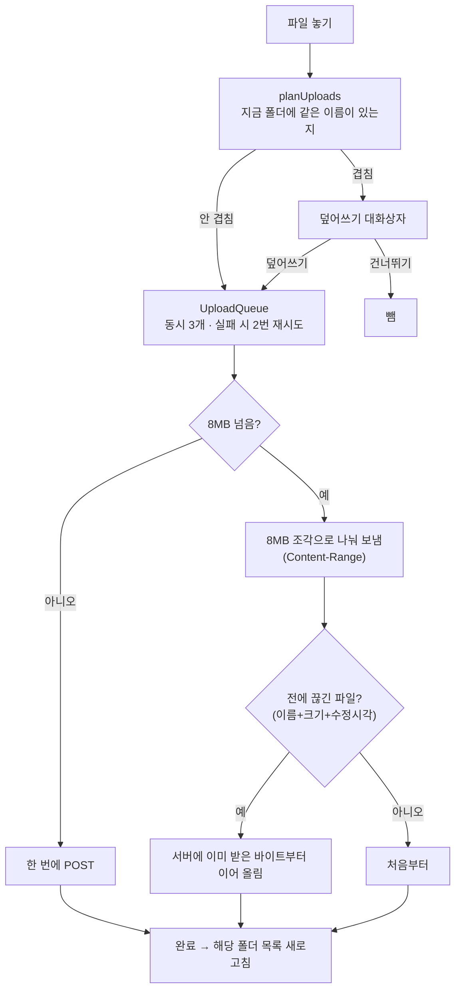

- **이어 올리기**: 이 앱이 조각 업로드를 시작했다가 끝내지 못한 파일만 기록해 둔다 (`resumeRegistry.ts`). 이름만 같은 다른 파일이 예전 조각에 이어 붙어 손상되는 일을 막는다.
- **취소·재시도**: 업로드 패널에서 항목별로 할 수 있다.
- **401**을 받으면 재시도하지 않고 바로 실패 처리한 뒤 로그인 안내로 넘긴다.
- 겹침 확인은 **지금 폴더 바로 아래 이름만** 본다. 폴더를 통째로 올릴 때 하위 경로의 같은 이름 파일은 서버가 덮어쓴다(알려진 단순화).

---

## 7. 다운로드

- 우클릭·메뉴로 받는다. 저장 위치는 설정의 **다운로드 위치**, 비어 있으면 받을 때마다 묻는다.
- **DownloadQueue**: 동시 2개. 임시 다운로드 링크는 만료되므로 시작 직전에 받는다.
- 실제 저장은 Tauri upload 플러그인의 `download`가 디스크로 직접 스트리밍한다.
- 다운로드 패널에서 진행 상황을 보고, 끝나면 **"폴더에서 보기"**로 연다.
- 다운로드 **취소는 없다**. 플러그인에 중단 기능이 없어서다.
- 같은 이름 파일이 있으면 "이름 (1).확장자"처럼 번호를 붙인다 (`free_path` 명령).

---

## 8. 미리보기

| 종류 | 확장자 |
| --- | --- |
| 이미지 | png, jpg, jpeg, gif, webp, svg, bmp |
| 텍스트 | txt, md, markdown, json, js, ts, tsx, jsx, css, html, htm, xml, yml, yaml, toml, ini, log, sh, py, rs, go, java, c, cpp, h |
| PDF | pdf |

- **마크다운**은 서식을 입혀 보여 준다 (react-markdown + GFM, GitHub Flavored Markdown).
- 텍스트는 1MB까지 보여 준다.
- 미리보기 안에서 `←` `→`로 같은 폴더의 이전·다음 파일로 넘어간다.

| 키 (미리보기 안) | 동작 |
| --- | --- |
| `Esc` | 닫기 |
| `←` / `→` | 이전 / 다음 파일 |
| `I` | 정보 패널 열고 닫기 |
| `+` / `-` | 확대 / 축소 |
| `0` | 화면에 맞춤 |
| `1` | 실제 크기 |
| `R` | 회전 |

---

## 9. 검색


- **모든 저장소**를 하위 폴더까지 이름으로 찾는다. 암호화 저장소는 뺀다.
- 내용이 바뀐 저장소만 다시 받는다. 그래서 두 번째부터는 빠르다.
- 결과를 고르면 폴더는 그 안으로, 파일은 그 파일이 있는 폴더로 가서 해당 파일을 선택한다.
- localStorage 용량(약 5MB)을 넘는 큰 저장소는 캐시 없이 매번 받는다.
- Claude의 `search` 도구도 이 인덱스를 쓴다.

---

## 10. 공유 링크

- **만들기**: 파일·폴더 우클릭 → 공유. **비밀번호**와 **만료일**을 고를 수 있다.
  - 비밀번호 규칙은 Seahub 기본값을 따른다. **10자 이상**, 숫자·대문자·소문자·기호 중 **1종류 이상**. 서버 관리자가 규칙을 바꿨으면 서버가 거절하고, 그 문구를 그대로 보여 준다.
- **관리 페이지**(사이드바 "공유 링크"): 내가 만든 링크 전부. 이름·위치·만료·비밀번호 여부·조회수·만든 날짜를 보고, 주소 복사와 **삭제**를 할 수 있다. 삭제하면 링크를 받은 사람도 더는 열 수 없다.
- 상태 표시줄에 지금 폴더의 "링크 N개"가 나온다.

---

## 11. 휴지통

- 사이드바 "휴지통"(저장소를 먼저 골라야 한다). **저장소 단위**다.
- 이름·원래 위치·삭제한 날짜·크기를 보여 준다.
- 항목별 **복원**: 원래 폴더로 돌아간다.
- **비우기**: 그 저장소의 휴지통 전체를 영구 삭제한다. Seafile이 항목별 영구 삭제를 지원하지 않아서 전체만 된다.

---

## 12. 바로 보내기

같은 네트워크에 있고 **같은 Seafile 서버에 로그인한** U-Drive끼리 파일을 **직접** 주고받는다. 파일 내용은 서버를 거치지 않는다. **설치된 앱에서만** 동작한다.

### 12.1 켜지는 조건

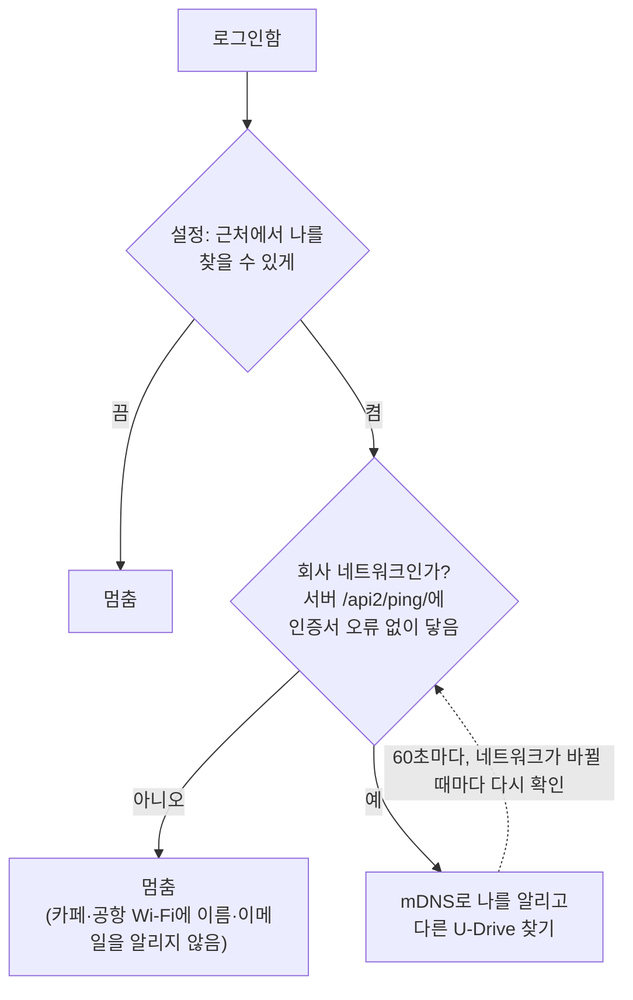

서버 이름은 회사 밖에서도 사설 IP로 풀리지만 밖에서는 닿지 않는다. 다른 PC가 그 IP를 쓰더라도 서버 인증서를 낼 수 없으므로, "서버에 TLS로 닿는가"로 회사 네트워크인지 판단한다.

### 12.2 찾기와 전송

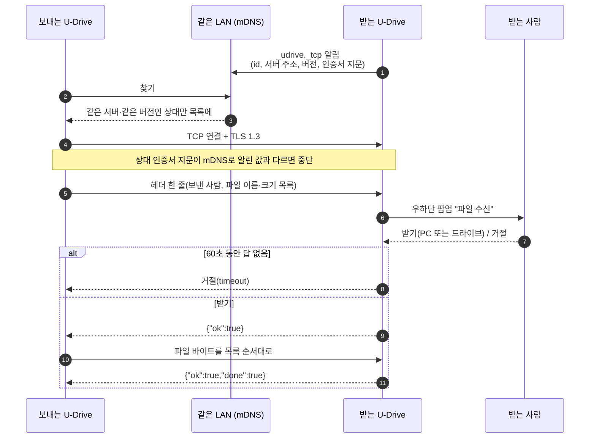

| 항목 | 값 |
| --- | --- |
| 찾기 | mDNS(multicast DNS), 서비스 이름 `_udrive._tcp` |
| 전송 | 전송 한 번 = TCP 연결 하나, TLS(Transport Layer Security) 1.3 |
| 인증서 | 실행할 때마다 새로 만드는 자체 서명 인증서. SHA-256 지문을 mDNS로 알린다 |
| 상대 확인 | 보내는 쪽만 확인한다(다른 PC가 주소를 가로채지 못하게). 받는 쪽은 사람이 받을지 정한다 |
| 프로토콜 버전 | 2. 버전이 다르면 서로 목록에 안 보인다 |
| 받을지 묻는 시간 | 60초, 지나면 거절 |
| 전송 중 무응답 | 30초면 끊는다 |
| 동시 연결 | 최대 8개, 동시에 묻는 요청은 최대 4개(팝업이 쏟아지지 않게) |

### 12.3 보내기

- 진입점: 사이드바 "바로 보내기", 파일 우클릭, 메뉴, 트레이 메뉴.
- **PC 파일 보내기**: 그대로 보낸다.
- **드라이브 파일 보내기**: 먼저 서버에서 앱 캐시 폴더로 내려받고(이때 "준비 중"으로 보인다), 보낸 뒤 지운다. 지난 실행에서 남은 임시 파일은 시작할 때 지운다.

### 12.4 받기

- 받는 쪽에는 **작은 별도 팝업 창**(`nearby-offer`)이 뜬다. 하던 작업을 끊지 않는다.
- **받을 위치**: PC 또는 드라이브. 처음 한 번 고르면 다음에도 그대로 쓰고, 설정에서 바꾼다.
  - **PC**: 설정한 PC 폴더, 없으면 다운로드 위치, 그것도 없으면 시스템 다운로드 폴더. 받은 파일은 OS에 "인터넷에서 온 파일"로 표시해서 처음 열 때 OS가 한 번 확인한다.
  - **드라이브**: 임시 폴더에 받은 뒤 업로드 큐로 올린다. 기본 폴더는 내 첫 저장소의 `/받은 파일`. 같은 이름이 있으면 덮어쓰지 않고 "이름 (1)"로 올린다. **200MB가 넘는 파일은 PC 폴더에** 받는다.
- 처음 켤 때 Windows 방화벽·macOS가 네트워크 접근을 물으면 허용해야 한다.

### 12.5 거절 사유

| 사유 | 문구 |
| --- | --- |
| `off` | 상대가 바로 보내기를 끄고 있습니다 |
| `server` | 다른 서버에 로그인한 사용자입니다 |
| `version` | 상대 U-Drive 버전이 맞지 않습니다 |
| `declined` / `timeout` / `busy` / `disk` | 거절, 시간 초과, 요청이 너무 많음, 저장 위치 없음 |

---

## 13. Claude 연결 (MCP)

Claude에서 "이 문서 유드라이브에 올려줘", "유드라이브에서 ○○ 받아줘"처럼 말로 파일을 다룬다. MCP(Model Context Protocol) 서버는 따로 없고, **설치된 U-Drive 앱이 그 역할**을 한다. 앱이 로그인돼 있어야 한다.

### 13.1 연결 구조

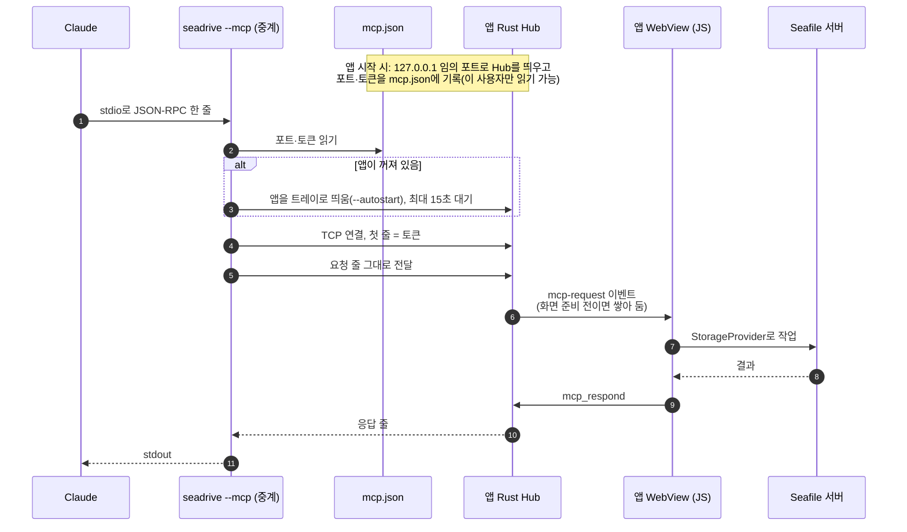

- 토큰이 틀리면 연결을 바로 닫는다. 토큰 비교는 시간이 내용과 무관하게 걸리도록 한다(한 글자씩 맞혀 보지 못하게).
- 화면이 새로고침되면 답을 못 받게 된 요청을 오류로 끝내고 다시 준비를 기다린다.
- 로그아웃 상태면 도구 호출에 로그인 안내로 답한다.

### 13.2 도구 목록

| 도구 | 하는 일 |
| --- | --- |
| `list_libraries` | 저장소 목록. 기본은 **내 저장소만**(`scope: mine`), `all`이면 공유받은 것까지 |
| `list_dir` | 폴더 목록. 크기·날짜는 "1.2 MB", "2026-10-29 07:57"처럼 읽기 좋은 형식 |
| `preview` | 이미지는 서버 축소본(1024px), 텍스트는 내용 그대로(1MB까지). **PC에 아무것도 쓰지 않는다** |
| `search` | 이름으로 최대 20개. 기본은 내 저장소만 |
| `upload_file` | PC 파일 경로들을 올린다 |
| `upload_text` | 채팅에서 쓴 텍스트를 UTF-8 파일로 만들어 올린다 |
| `upload_base64` | base64 내용을 파일로 올린다 |
| `download` | 드라이브 파일을 PC로 받는다. 기본 위치는 다운로드 폴더 아래 **"U-Drive 작업"** 폴더 |
| `recent_downloads` | 다운로드 폴더의 최근 파일(채팅에서 만든 파일을 사용자가 받은 뒤 찾아 올릴 때) |

### 13.3 규칙과 안전장치

- **저장소 범위**: "내 유드라이브"면 내 저장소만 본다. 못 찾으면 공유받은 저장소까지 찾을지 사용자에게 먼저 묻는다.
- 저장소를 생략했을 때 내 저장소가 하나면 그것을 쓴다. 여럿이면 후보를 알려 주며 실패한다.
- **덮어쓰기**: 같은 이름이 하나라도 있으면 전부 멈추고 알린다. 사용자가 동의했을 때만 `overwrite: true`.
- 올릴 폴더가 없으면 있는 상위 폴더까지 찾고, 나머지 경로는 서버가 만든다.
- 업로드·다운로드는 앱의 큐를 그대로 쓰므로 **앱 패널에도 뜬다**.
- **로컬 경로 차단** (`localPath.ts`): 공유 문서에 심긴 지시(프롬프트 인젝션)로 비밀 파일을 올리거나 자동 실행 폴더에 쓰는 것을 막는다.
  - 숨김 파일·폴더(`.`으로 시작), 네트워크 경로(UNC), 상대 경로
  - macOS `~/Library`, `/System`, `/usr`, `/etc` 등 시스템 폴더
  - Windows `AppData`, `Windows`, `Program Files`, `ProgramData`
  - 심볼릭 링크로 돌아가지 못하게 실제 경로도 확인한다.
- Claude가 준 파일 이름에서 경로 부분은 떼어 낸다(`../` 방지).
- PC 파일 읽기는 **200MB까지**. 넘으면 앱에서 직접 올리라고 안내한다.
- 쓸 때는 기존 파일을 덮어쓰지 않는다.

### 13.4 설치

- **Claude Code**: `claude plugin marketplace add cksrlcks/u-drive` → `claude plugin install u-drive@u-drive`
- **Claude 데스크톱 앱**: `claude-plugin/u-drive.mcpb`를 설정 → 확장 프로그램 화면에 끌어다 놓는다. U-Drive 설정 → Claude 연결의 받기 버튼도 같은 파일이다.
- `.mcpb`는 앱을 찾아 `seadrive --mcp`를 실행할 뿐이고 앱 자체는 들어 있지 않다. macOS는 `/Applications` → `~/Applications` → Spotlight 순서로 찾고, Windows는 `%LOCALAPPDATA%\Drive\seadrive.exe`를 쓴다.

---

## 14. 트레이·창·자동 실행

- **창 닫기 = 트레이로 숨기기**(설정에서 끄면 종료). macOS는 메뉴 막대에 흑백 템플릿 아이콘으로 뜬다.
- **트레이 메뉴**: U-Drive 열기 / 파일 업로드… / 바로 보내기… / 새로고침 / 다운로드 폴더 열기 / 설정… / 로그아웃 / 버전 표시 / 종료.
- 트레이 아이콘 왼쪽 클릭, macOS Dock 아이콘 클릭으로 창을 다시 띄운다.
- **단일 실행**: 이미 떠 있으면 새로 띄우지 않고 기존 창을 앞으로 가져온다.
- **자동 실행**: 컴퓨터를 켜면 `--autostart`로 창 없이 트레이에만 뜬다. Claude 중계가 앱을 띄울 때도 같은 방식이다.
- Windows·macOS 각각에 맞춘 제목 표시줄과 창 버튼을 직접 그린다.

---

## 15. 설정

`Ctrl/⌘+,` 또는 메뉴·트레이에서 연다.

| 페이지 | 항목 |
| --- | --- |
| **내 계정** | 이름, 이메일, 사용량(할당량 대비), 비밀번호 변경(서버 웹 설정 페이지를 브라우저로 연다. 일반 사용자용 변경 API가 없어서), 접속 서버, 로그아웃 |
| **일반** | 테마(시스템·라이트·다크), 화면 크기(배율), 자동 실행, 창을 닫아도 트레이에서 계속 실행, 다운로드 위치, 이미지 썸네일 표시, 문제 해결(로그 폴더 열기) |
| **바로 보내기** | 근처에서 나를 찾을 수 있게, 받을 위치(PC·드라이브), PC 폴더, 드라이브 폴더 |
| **Claude 연결** | Claude Code 설치 명령, Claude 데스크톱 확장 파일 받기와 단계별 안내 |

- 앱 설정은 localStorage `seadrive.prefs`에 저장된다. 그중 Rust가 써야 하는 값(트레이 닫기, 다운로드 폴더)은 `set_prefs`로 넘긴다.
- 다른 창(바로 보내기 팝업 ↔ 메인)에서 바꾼 설정을 바로 따른다.
- 글꼴(시스템·Pretendard·Geist) 값도 설정에 있다.

---

## 16. 자동 업데이트

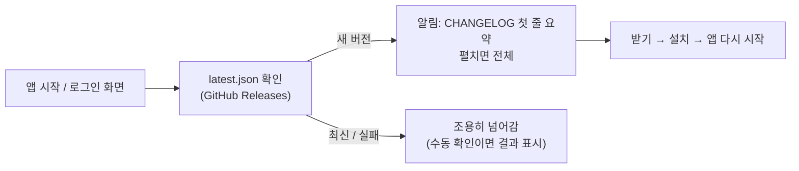

- Tauri updater 플러그인을 쓴다. 업데이트 파일은 서명을 확인한다.
- 로그인하지 않은 상태(로그인 화면)에서도 확인·설치할 수 있다.
- 알림 문구는 `CHANGELOG.md`의 해당 버전 섹션에서 온다.

---

## 17. 오류 로그

- 처리되지 않은 오류와 기능별 오류를 **앱 로그 폴더의 `drive.log`**에 한 줄씩 남긴다.
  - Windows: `%LOCALAPPDATA%\com.chang.seadrive\logs`
  - macOS: `~/Library/Logs/com.chang.seadrive`
- 1MB가 넘으면 `drive.old.log`로 넘기고 새로 쓴다(최대 약 2MB).
- 인증 토큰(40자 이상 16진수)과 UUID(공유·업로드 링크)는 `<가림>`으로 가린다.
- 사용자는 설정 → 일반 → 문제 해결에서 폴더를 열어 담당자에게 보낸다.

---

## 18. 개발·검사·릴리스

### 18.1 명령

| 명령 | 용도 |
| --- | --- |
| `npm ci` | 의존성 설치 |
| `npm run tauri dev` | 데스크톱 앱으로 실행 |
| `npm run dev` | 브라우저에서 화면만 (`http://localhost:1420`) |
| `npm run build` | `tsc && vite build` |
| `npm test` | vitest |
| `npm run lint` | 저장소 추상화 누수·디자인 토큰 위반 검사 |
| `cargo check --locked` | Rust 확인 (`src-tauri`에서) |

### 18.2 린트가 막는 것

- `seafile`이라는 말이 `src/storage/seafile/`와 허용된 몇 곳 밖에 나오는 것(화면이 Seafile에 직접 의존하는 것).
- `docs/DESIGN.md`의 디자인 토큰 규칙 위반.

### 18.3 릴리스

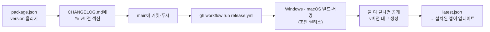

- CHANGELOG 섹션이 없으면 빌드가 실패한다.
- 필요한 시크릿: `TAURI_SIGNING_PRIVATE_KEY`, `TAURI_SIGNING_PRIVATE_KEY_PASSWORD`. macOS 정식 서명·공증은 `docs/macos-release.md`.
- macOS는 지금 ad-hoc 서명이라 처음 한 번 "그래도 열기"가 필요하다.

---

## 19. 로컬 저장소 키 정리

| 위치 | 키·파일 | 내용 |
| --- | --- | --- |
| localStorage | `seadrive.session` | 서버 주소, (자동 로그인이면) 토큰 |
| sessionStorage | `seadrive.session` | (자동 로그인 끔) 이번 실행의 토큰 |
| localStorage | `seadrive.loginPrefs` | 저장한 아이디, 자동 로그인 여부 |
| localStorage | `seadrive.deviceId` | 설치마다 하나인 40자 기기 id |
| localStorage | `seadrive.prefs` | 앱 설정 |
| localStorage | `seadrive.thumbnails` | 썸네일 표시 여부 |
| localStorage | `seadrive.index.<저장소id>` | 검색 인덱스 캐시 |
| localStorage | `seadrive.interruptedUploads` | 이어 올릴 대상 파일 기록 |
| 앱 설정 폴더 | `mcp.json` | Claude 중계용 포트·토큰 (이 사용자만 읽기) |
| 앱 캐시 폴더 | `nearby/`, `nearby-in/` | 바로 보내기 임시 파일 |
| 앱 로그 폴더 | `drive.log`, `drive.old.log` | 오류 로그 |

---

## 20. 서버를 거치는가: 기능별 정리

| 기능 | Seafile 서버 | 기타 외부 |
| --- | --- | --- |
| 로그인·탐색·파일 작업·업로드·다운로드·미리보기·검색·공유·휴지통 | 거침 (HTTPS API) | — |
| 바로 보내기: PC → PC | **안 거침** (TLS 직접 전송). 회사 네트워크 판정에 `/api2/ping/`만 부름 | 같은 LAN의 상대 PC |
| 바로 보내기: 드라이브 파일 보내기 | 보내기 전에 서버에서 내려받음 | 상대 PC |
| 바로 보내기: 드라이브로 받기 | 받은 뒤 서버로 올림 | 상대 PC |
| Claude 연결 | 도구가 하는 작업만큼 거침 | Claude ↔ 앱은 PC 안(127.0.0.1)에서만 |
| 자동 업데이트 | — | GitHub Releases |
| OS 아이콘·트레이·로그 | — | — |

---

## 21. 기능별 출처: Seafile API vs 자체 개발

기능마다 Seafile이 이미 제공하는 것을 그대로 썼는지, 앱에서 새로 만들었는지 나눈다. 세 단계로 구분한다.

| 표시 | 뜻 |
| --- | --- |
| 🟦 **Seafile** | Seafile API를 거의 그대로 부른다. 앱은 요청을 보내고 결과 모양만 바꾼다 |
| 🟨 **Seafile + 자체** | Seafile API 위에 앱이 로직·화면을 상당 부분 더했다 |
| 🟩 **자체** | Seafile과 상관없이 앱에서 새로 만들었다. Seafile을 쓰더라도 데이터를 가져오는 정도다 |

### 21.1 한눈에 보기

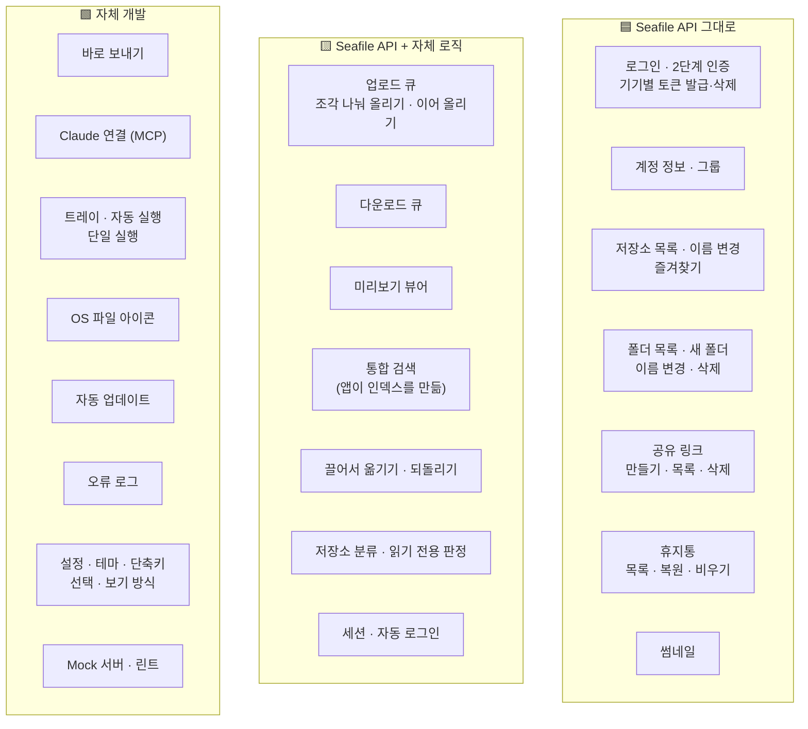

### 21.2 기능별 표

| 기능 | 구분 | Seafile이 해 주는 것 | 앱이 따로 만든 것 |
| --- | --- | --- | --- |
| **로그인** | 🟦 | 토큰 발급(`/api2/auth-token/`), OTP 확인(`X-SEAFILE-OTP` 헤더) | 로그인 화면, 오류 문구 변환 |
| **기기별 토큰** | 🟦 | 기기별 토큰 발급, 웹의 "연결된 기기" 목록, 기기 로그아웃(`/api2/logout-device/`) | 40자 기기 id 생성·보관, PC 이름 읽기(Rust) |
| **세션 저장·자동 로그인** | 🟩 | — | 토큰 보관 위치 선택(localStorage/sessionStorage), 아이디 저장, https 강제, 예전 서버 주소를 새 주소로 옮기기 |
| **계정 정보** | 🟦 | 이름·이메일·사용량·할당량(`/api2/account/info/`) | 내부 ID(`…@auth.local`) 대신 `contact_email` 표시 |
| **비밀번호 변경** | 🟦 | 서버 웹의 `/profile/` 페이지 | 브라우저로 열기만 한다 (일반 사용자용 API가 없음) |
| **저장소 목록** | 🟨 | 저장소 목록(`/api2/repos/`), 즐겨찾기 목록 | 소유·그룹·공유로 여러 번 오는 같은 저장소를 하나로 합치기(소유 > 그룹 > 공유), 섹션 나누기, 권한(`r`, `preview`, `cloud-edit`)으로 읽기 전용 판정, 암호화 저장소 막기 |
| **저장소 즐겨찾기·이름 변경** | 🟦 | `/api/v2.1/starred-items/`, `/api2/repos/:id/?op=rename` | — |
| **폴더 목록** | 🟦 | `/api2/repos/:id/dir/` | 폴더 먼저 정렬 |
| **목록·아이콘 보기, 열 조절, 정렬** | 🟩 | — | 전부 |
| **선택(클릭·Shift·사각형)·키보드 탐색·뒤로/앞으로** | 🟩 | — | 전부 |
| **OS 파일 아이콘** | 🟩 | — | Rust가 Windows 셸·macOS NSWorkspace 아이콘을 PNG로 그림 |
| **이미지 썸네일** | 🟦 | 축소본 생성(`/api2/repos/:id/thumbnail/`) | 표시 여부 설정 |
| **상세 패널** | 🟩 | — | 이미 받은 목록·공유 정보로 화면만 구성 |
| **새 폴더·이름 변경·삭제** | 🟦 | `dir/?operation=mkdir`, `operation=rename`, `DELETE` | 목록 안 이름 입력, 쓸 수 없는 이름 미리 검사, 삭제 확인 대화상자 |
| **끌어서 옮기기** | 🟨 | 여러 항목 이동(`/api/v2.1/repos/sync-batch-move-item/`) | 끌기 동작, 같은 저장소의 하위 폴더로만 제한, **되돌리기**(반대 방향으로 다시 이동 요청) |
| **업로드** | 🟨 | 업로드 링크(`upload-link`), 조각 업로드 프로토콜(`Content-Range`), 이미 받은 바이트 조회(`file-uploaded-bytes`), 중간 폴더 자동 생성(`relative_path`) | 큐(동시 3개·재시도 2번·취소), 8MB 조각 나누기, **이어 올릴 파일 기록**(이름+크기+수정시각), 업로드 링크 만료 시 다시 받기, 덮어쓰기 확인 대화상자, 끌어다 놓기·폴더 구조 유지 |
| **다운로드** | 🟨 | 임시 다운로드 링크(`/api2/repos/:id/file/`) | 큐(동시 2개), 시작 직전에 링크 받기, 디스크로 직접 저장(Tauri 플러그인), 같은 이름이면 번호 붙이기, 폴더에서 보기 |
| **미리보기** | 🟨 | 파일 내용(다운로드 링크), 썸네일 | 뷰어 전부: 확대·축소·회전, 이전/다음 파일, 마크다운 렌더링, PDF 표시, UTF-8이 아니면 EUC-KR로 다시 읽기 |
| **통합 검색** | 🟨 | 저장소 전체 트리 한 번에(`/api/v2.1/repos/:id/dir/?recursive=1`), 내용이 바뀌었는지 알 수 있는 `head_commit_id` | **Seafile 검색 API는 쓰지 않는다.** 인덱스 만들기, 저장소별 캐시와 갱신 판단, 이름 일치 순위 매기기 |
| **공유 링크 만들기** | 🟦 | 링크 생성(비밀번호·만료일, `/api/v2.1/share-links/`) | 비밀번호 규칙 사전 검사(Seahub 기본값을 옮겨 둠), 서버 오류 문구 변환 |
| **공유 링크 관리** | 🟦 | 목록·조회수·삭제 | 관리 페이지, 목록의 공유 표시, 상태 표시줄 "링크 N개" |
| **휴지통** | 🟦 | 목록(100개씩), 복원(`operation=revert`), 비우기(`keep_days=0`) | 최대 10페이지까지 이어 받기, 휴지통 페이지 |
| **바로 보내기** | 🟩 | 회사 네트워크 판정용 `/api2/ping/` 접속만. 드라이브 파일을 보내거나 드라이브로 받을 때는 위의 다운로드·업로드를 그대로 씀 | mDNS 찾기, TLS 1.3 직접 전송, 인증서 지문 확인, 받기 팝업 창, 받을 위치, 드라이브로 받을 때 같은 이름에 번호 붙이기, 200MB 기준 나누기, OS에 "인터넷에서 온 파일" 표시 |
| **Claude 연결 (MCP)** | 🟩 | 도구가 하는 작업(목록·검색·업로드·다운로드·썸네일)은 위의 API를 그대로 씀 | 중계 프로세스, 127.0.0.1 Hub와 토큰, MCP 프로토콜 처리, 도구 9개 설계, 내 저장소 범위 규칙, 로컬 경로 차단, 덮어쓰기 동의 규칙 |
| **트레이·자동 실행·단일 실행** | 🟩 | — | 전부 (Tauri 플러그인 사용) |
| **자동 업데이트** | 🟩 | — | GitHub Releases `latest.json` + Tauri updater, CHANGELOG로 알림 문구 |
| **설정** | 🟩 | — | 전부. 계정 페이지의 값만 계정 정보 API에서 옴 |
| **오류 로그** | 🟩 | — | 전부 (토큰·링크 가리기, 1MB 넘으면 새 파일) |
| **Mock 서버** | 🟩 | — | 서버 없이 화면을 확인하는 인메모리 구현 |

### 21.3 앱이 쓰는 Seafile API 전체 목록

모두 `src/storage/seafile/SeafileProvider.ts`에 있다. 예외는 마지막 두 줄이다.

| 메서드 | 경로 | 쓰는 기능 |
| --- | --- | --- |
| POST | `/api2/auth-token/` | 로그인, 기기별 토큰 |
| POST | `/api2/logout-device/` | 로그아웃(서버 토큰 삭제) |
| GET | `/api2/account/info/` | 계정 정보, 바로 보내기의 내 이름·이메일 |
| GET | `/api/v2.1/groups/` | 그룹 이름 |
| GET | `/api2/repos/` | 저장소 목록 |
| GET·POST·DELETE | `/api/v2.1/starred-items/` | 저장소 즐겨찾기 |
| POST | `/api2/repos/:id/?op=rename` | 저장소 이름 변경 |
| GET | `/api2/repos/:id/dir/?p=` | 폴더 목록 |
| POST | `/api2/repos/:id/dir/?p=` (`operation=mkdir`) | 새 폴더 |
| POST | `/api2/repos/:id/{file,dir}/?p=` (`operation=rename`) | 이름 변경 |
| DELETE | `/api2/repos/:id/{file,dir}/?p=` | 삭제 |
| POST | `/api/v2.1/repos/sync-batch-move-item/` | 끌어서 옮기기, 되돌리기 |
| GET | `/api2/repos/:id/upload-link/` | 업로드 링크 받기 |
| POST | (받은 업로드 링크)`?ret-json=1` | 실제 업로드. 조각이면 `Content-Range` 헤더, 항상 `replace=1` |
| GET | `/api/v2.1/repos/:id/file-uploaded-bytes/` | 이어 올리기 시작 위치 |
| GET | `/api2/repos/:id/file/?p=&reuse=1` | 다운로드·미리보기 링크 |
| GET | `/api2/repos/:id/thumbnail/` | 썸네일, Claude `preview` 이미지 |
| GET | `/api/v2.1/repos/:id/dir/?p=/&recursive=1` | 검색 인덱스 |
| GET·POST | `/api/v2.1/share-links/` | 공유 링크 목록·만들기 |
| DELETE | `/api/v2.1/share-links/:token/` | 공유 링크 삭제 |
| GET | `/api/v2.1/repos/:id/trash/` | 휴지통 목록 |
| POST | `/api/v2.1/repos/:id/{file,dir}/` (`operation=revert`) | 휴지통 복원 |
| DELETE | `/api/v2.1/repos/:id/trash/?keep_days=0` | 휴지통 비우기 |
| GET | `/api2/ping/` | 바로 보내기의 회사 네트워크 판정 (`src/features/nearby/nearby.ts`, `no-cors`라 연결만 확인) |
| (웹 페이지) | `/profile/` | 비밀번호 변경 화면 열기 (`SettingsDialog.tsx`) |

### 21.4 알아 둘 점

- **덮어쓰기 판단은 앱이 한다.** 업로드 요청에는 항상 `replace=1`을 보내므로, 같은 이름이 있으면 서버는 묻지 않고 덮어쓴다. 덮어쓰기 대화상자, Claude의 `overwrite` 동의, 바로 보내기의 "이름 (1)" 처리는 모두 올리기 **전에** 앱이 목록을 보고 막는 방식이다.
- **검색은 서버 검색 엔진에 의존하지 않는다.** Seafile Pro의 전문 검색(파일 내용 검색)은 쓰지 않는다. 이름 검색만 되고, 저장소가 크면 처음 인덱스를 받는 데 시간이 걸린다.
- **이동은 같은 저장소 안에서만** 쓴다. API는 저장소 간 이동도 받지만 앱이 막아 두었다.
- **암호화 저장소**는 Seafile이 지원하지만 앱은 열지 않는다(비밀번호 입력·복호화 흐름을 만들지 않음).
- **Seafile 웹에만 있는 기능**(앱에 없음): 저장소 만들기·삭제, 사용자·그룹 공유 설정, 파일 이력·버전 되돌리기, 파일 잠금, 온라인 문서 편집, 업로드 링크 만들기, 태그·댓글, 관리자 기능.

---

## 22. 보안 처리 사항

v0.11.2 기준으로 코드에 들어가 있는 보안 조치다.

### 22.1 신뢰 경계

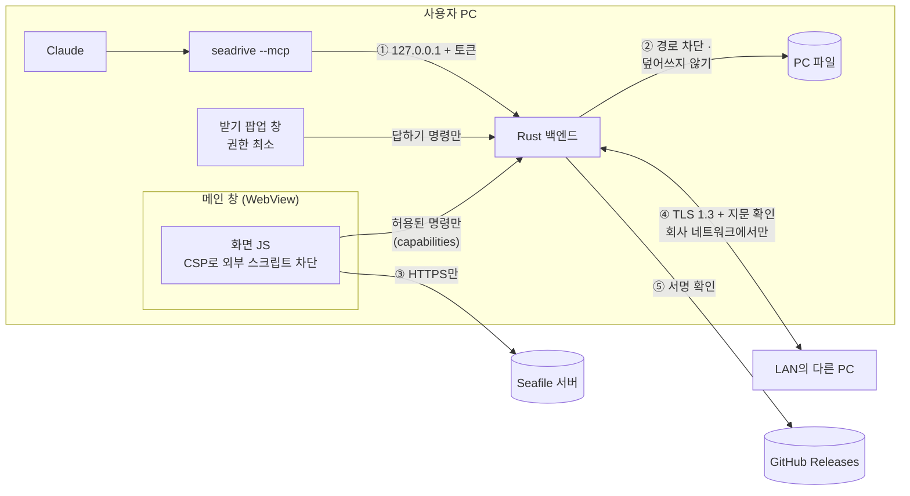

번호는 아래 절과 대응한다. ① 22.4, ② 22.4, ③ 22.2, ④ 22.5, ⑤ 22.7.

### 22.2 서버 연결과 인증

| 조치 | 내용 | 위치 |
| --- | --- | --- |
| **HTTPS만 허용** | `http://` 서버 주소는 거절한다(비밀번호·토큰이 평문으로 나가므로). 예외는 개발용 `mock`과 `localhost`·`127.0.0.1`·`[::1]`뿐이다 | `session.ts` `isSecureServer`, `connectionFor` |
| **예전 http 주소 정리** | 저장된 http 주소로는 요청하지 않고 기본 https 주소로 다시 로그인하게 한다. 서버를 옮긴 주소는 새 주소로 바꿔 읽는다 | `session.ts` `loadSession` |
| **기기별 토큰(TokenV2)** | PC마다 따로 토큰을 받는다. 사용자가 Seafile 웹에서 이 PC만 끊을 수 있다 | `device.ts`, `SeafileProvider.login` |
| **로그아웃 시 서버 토큰 삭제** | `/api2/logout-device/`로 서버에서도 토큰을 지운다. 서버에 닿지 않아도 로컬 로그아웃은 된다 | `SeafileProvider.logout` |
| **토큰 보관 선택** | 자동 로그인을 끄면 토큰을 sessionStorage에만 두어 앱을 닫으면 사라진다 | `session.ts` `saveSession` |
| **2단계 인증 지원** | 서버가 OTP를 요구하면 입력받아 헤더로 보낸다 | `SeafileProvider.login`, `api.ts` |
| **401 즉시 처리** | 인증이 만료되면 재시도하지 않고 로그인 화면으로 보낸다 | `App.tsx`, `uploadQueue.ts` |
| **리다이렉트 따라가지 않기** | API 요청은 `redirect: "manual"`이라 다른 주소로 토큰이 딸려 가지 않는다 (원래 목적은 Seahub의 301 응답 처리) | `api.ts` |

### 22.3 앱 자체 (WebView·권한)

| 조치 | 내용 | 위치 |
| --- | --- | --- |
| **CSP(Content Security Policy)** | 스크립트는 앱 번들(`'self'`)만, `object-src 'none'`, `form-action 'none'`, `base-uri 'self'`. 외부에서 받은 스크립트가 실행되지 않는다 | `tauri.conf.json` `security.csp` |
| **창별 권한 분리(capabilities)** | 메인 창은 필요한 명령만 허용 목록에 올린다. 바로 보내기 **받기 팝업 창은 답하기·설정·로그 명령만** 쓸 수 있고 파일 읽기·쓰기는 못 한다 | `src-tauri/capabilities/*.json` |
| **HTML 미리보기 격리** | HTML 파일은 `sandbox=""` iframe에 그린다. 스크립트·폼 전송·팝업·상위 창 이동이 모두 막히고 출처도 앱과 분리된다 | `PreviewModal.tsx` |
| **마크다운 미리보기** | react-markdown 기본 설정이라 문서 안의 원시 HTML을 그리지 않는다 | `MarkdownView.tsx` |
| **SVG** | 이미지 태그로만 그려서 SVG 안의 스크립트가 실행되지 않는다 | `PreviewModal.tsx` |
| **단일 실행** | 앱은 하나만 뜬다. 두 번째 실행은 기존 창을 앞으로 가져올 뿐이다 | `lib.rs` single-instance |

### 22.4 Claude 연결 (MCP)

공유 문서에 숨겨 둔 지시(프롬프트 인젝션)로 Claude가 엉뚱한 파일을 다루는 상황을 주로 막는다.

| 조치 | 내용 | 위치 |
| --- | --- | --- |
| **PC 안에서만 접속** | Hub는 `127.0.0.1`에만 열린다. 다른 PC에서는 붙을 수 없다 | `mcp.rs` `Hub::start` |
| **접속 토큰** | 앱을 켤 때마다 OS 난수로 128비트 토큰을 만든다. 첫 줄이 토큰과 다르면 연결을 끊는다 | `mcp.rs` `new_token`, `serve` |
| **일정 시간 비교** | 토큰 비교 시간이 내용과 무관하게 걸린다(한 글자씩 맞혀 보지 못하게) | `mcp.rs` `same` |
| **토큰 줄 제한** | 토큰 줄은 256바이트, 5초 안에 와야 한다. 아무 프로그램이 붙어 붙잡고 있지 못하게 한다 | `mcp.rs` `TOKEN_LINE_MAX` |
| **토큰 파일 권한** | `mcp.json`은 이 사용자만 읽는다(macOS 0600. 예전에 0644로 만든 파일도 고친다. Windows는 `%APPDATA%`가 사용자 전용) | `mcp.rs` `write_private` |
| **중계가 앱을 띄울 때 물려주지 않기** | Claude의 표준 입출력과 작업 폴더를 앱에 넘기지 않는다 | `mcp.rs` `autostart_command` |
| **로컬 경로 차단** | 숨김 파일·폴더, 네트워크(UNC) 경로, 상대 경로, macOS `~/Library`와 시스템 폴더, Windows `AppData`·`Windows`·`Program Files`·`ProgramData`를 거절한다. 비밀 파일(`~/.ssh`, 브라우저 프로필)을 올리거나 자동 실행 폴더·`.git/hooks`에 쓰는 것을 막는다 | `localPath.ts` `blockedLocalPath` |
| **링크 우회 차단** | 심볼릭 링크를 따라간 실제 경로도 같은 규칙으로 검사한다 | `localfs.rs` `real_path`, `tools.ts` `allowLocal` |
| **파일 이름에서 경로 제거** | Claude가 준 이름의 `../` 같은 경로 부분을 떼어 다른 폴더에 쓰지 못하게 한다 | `localPath.ts` `plainFileName`, `lib.rs` `free_path` |
| **덮어쓰지 않기** | PC에 쓸 때는 새 파일로만 만든다(`create_new`). 같은 이름이면 번호를 붙인다 | `localfs.rs` `write_new` |
| **드라이브 덮어쓰기 동의** | 같은 이름이 하나라도 있으면 전부 멈추고, 사용자가 동의했을 때만 `overwrite: true` | `tools.ts` |
| **base64 무결성 확인** | `upload_base64`는 sha256이 맞지 않으면 아무것도 하지 않는다. 사용자 확인 후에만 부르도록 도구 설명에 적었다 | `tools.ts` |
| **크기 상한** | PC 파일 읽기는 200MB까지 | `localfs.rs` `READ_CAP` |
| **기본 범위는 내 저장소** | 공유받은 저장소는 사용자가 말할 때만 본다 | `tools.ts` `scopedLibraries` |
| **미리보기는 PC에 쓰지 않음** | `preview`는 내용을 바로 돌려줄 뿐 파일을 만들지 않는다 | `tools.ts` |
| **작업 파일 분리** | Claude가 받는 파일은 다운로드 폴더 아래 "U-Drive 작업" 폴더에 둔다 | `McpBridge.tsx`, `tools.ts` |
| **로그아웃이면 거절** | 로그인돼 있지 않으면 도구가 동작하지 않고 로그인 안내만 한다 | `McpBridge.tsx` |

### 22.5 바로 보내기

| 조치 | 내용 | 위치 |
| --- | --- | --- |
| **암호화** | 모든 전송은 TLS 1.3이다 | `tls.rs` |
| **상대 확인(인증서 지문 고정)** | 받는 쪽은 실행마다 자체 서명 인증서를 새로 만들고 SHA-256 지문을 mDNS로 알린다. 보내는 쪽은 연결한 상대의 지문이 그 값과 같을 때만 보낸다. 다른 PC가 주소를 가로채 대신 받지 못한다 | `tls.rs` `verify_server_cert` |
| **회사 네트워크에서만** | 서버 `/api2/ping/`에 인증서 오류 없이 닿을 때만 켠다. 카페·공항 Wi-Fi에서 이름·이메일을 알리지 않는다. 60초마다, 네트워크가 바뀔 때마다 다시 본다 | `NearbyRoot.tsx`, `nearby.ts` `serverReachable` |
| **같은 서버 사용자만** | 서버 주소가 다르면 목록에 넣지 않고 받기도 거절한다 | `nearby.rs` `on_event`, `check_offer` |
| **사용자 동의** | 받는 사람이 "받기"를 눌러야 받는다. 60초 안에 답이 없으면 거절한다 | `nearby.rs` `ASK_TIMEOUT` |
| **팝업 폭탄 방지** | 동시에 묻는 요청은 최대 4개, 같은 PC가 이미 묻는 중이면 `busy`로 거절한다 | `nearby.rs` `MAX_ASKS` |
| **연결 수 제한** | 동시 연결은 최대 8개. 넘으면 바로 끊는다 | `nearby.rs` `MAX_CONNS` |
| **입력 크기 제한** | 헤더 한 줄은 256KB, 파일은 최대 10,000개 | `nearby.rs` `MAX_LINE`, `check_offer` |
| **무응답 끊기** | 전송 중 30초간 아무것도 오지 않으면 끊는다 | `nearby.rs` `IO_TIMEOUT` |
| **안전한 파일 이름** | 상대가 준 이름에서 경로를 떼고, OS가 못 쓰는 글자(`<>:"\|?*`, 제어 문자)를 바꾸고, 끝의 점·공백을 지운다 | `nearby.rs` `safe_name` |
| **이름 위장 차단** | 보이지 않거나 글자 방향을 바꾸는 문자를 지운다. "보고서‮fdp.exe"가 "보고서exe.pdf"처럼 보이는 것을 막는다 | `nearby.rs` `is_invisible` |
| **덮어쓰지 않기** | 새 파일로만 만들고(`create_new`) 같은 이름이면 번호를 붙인다 | `nearby.rs` `create_free` |
| **정확한 크기만 받기** | 알린 크기만큼만 받는다. 중간에 끊기면 받던 파일은 지운다 | `nearby.rs` `copy_exact`, `recv_files` |
| **"인터넷에서 온 파일" 표시** | macOS는 `com.apple.quarantine` 속성(Gatekeeper 검사), Windows는 `Zone.Identifier`(ZoneId=3, SmartScreen·Office 제한된 보기)를 붙인다 | `nearby.rs` `mark_from_network` |
| **버전 확인** | 프로토콜 버전이 다르면(암호화 전 버전 등) 서로 보이지 않는다 | `nearby.rs` `VERSION` |
| **임시 파일 정리** | 드라이브 파일을 보낼 때 쓴 임시 파일과 지난 실행에서 남은 것을 지운다 | `nearby.rs` `setup`, `nearby_cleanup` |

### 22.6 데이터 보호

| 조치 | 내용 | 위치 |
| --- | --- | --- |
| **로그 가리기** | 40자 이상 16진수(인증 토큰)와 UUID(공유·업로드 링크)를 `<가림>`으로 바꿔 기록한다 | `errorLog.ts` `redact` |
| **로그 크기 제한** | 1MB가 넘으면 새 파일로 넘겨 최대 약 2MB만 남긴다 | `lib.rs` `append_log` |
| **이어 올리기 오염 방지** | 이 앱이 시작했다가 끊긴 파일(이름+크기+수정시각)만 서버의 예전 조각에 이어 붙인다. 이름만 같은 다른 파일이 섞여 손상되거나 거짓으로 완료되는 것을 막는다 | `resumeRegistry.ts` |
| **공유 링크 비밀번호 규칙** | 10자 이상, 문자 종류 1가지 이상을 미리 검사한다(서버 규칙이 최종) | `passwordPolicy.ts` |
| **권한에 맞춘 화면** | 읽기 전용 저장소는 업로드·새 폴더·이름 변경·삭제 메뉴를 끈다 (최종 권한은 서버가 판단) | `SeafileProvider.listLibraries`, `MainScreen.tsx` |
| **암호화 저장소 열지 않기** | 비밀번호 처리 흐름이 없으므로 열지 않는다 | `Sidebar.tsx` |

### 22.7 배포와 업데이트

| 조치 | 내용 | 위치 |
| --- | --- | --- |
| **업데이트 서명 확인** | 업데이트 파일을 minisign 공개 키로 확인한 뒤에만 설치한다. 서명 키는 GitHub 시크릿에만 있다 | `tauri.conf.json` `plugins.updater.pubkey`, `release.yml` |
| **업데이트 주소 고정** | GitHub Releases의 `latest.json`만 본다 (HTTPS) | `tauri.conf.json` `endpoints` |
| **macOS 서명** | 지금은 ad-hoc 서명. 정식 서명·공증 절차는 `docs/macos-release.md` | `release.yml` |
