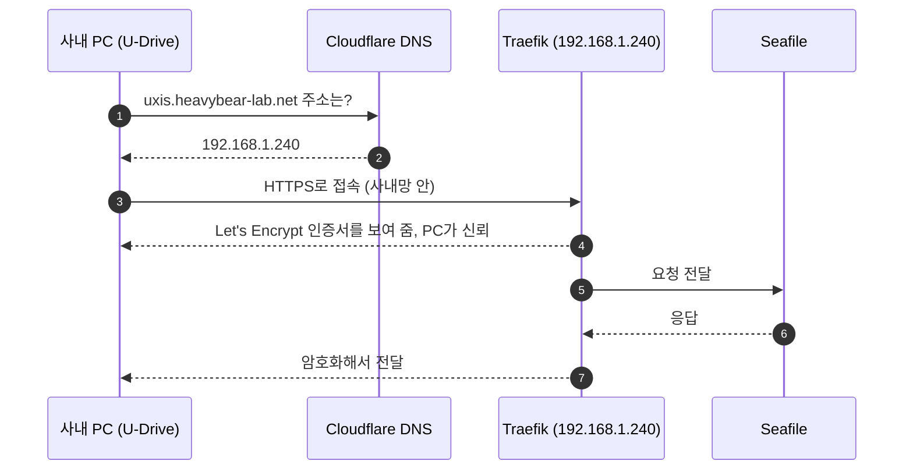
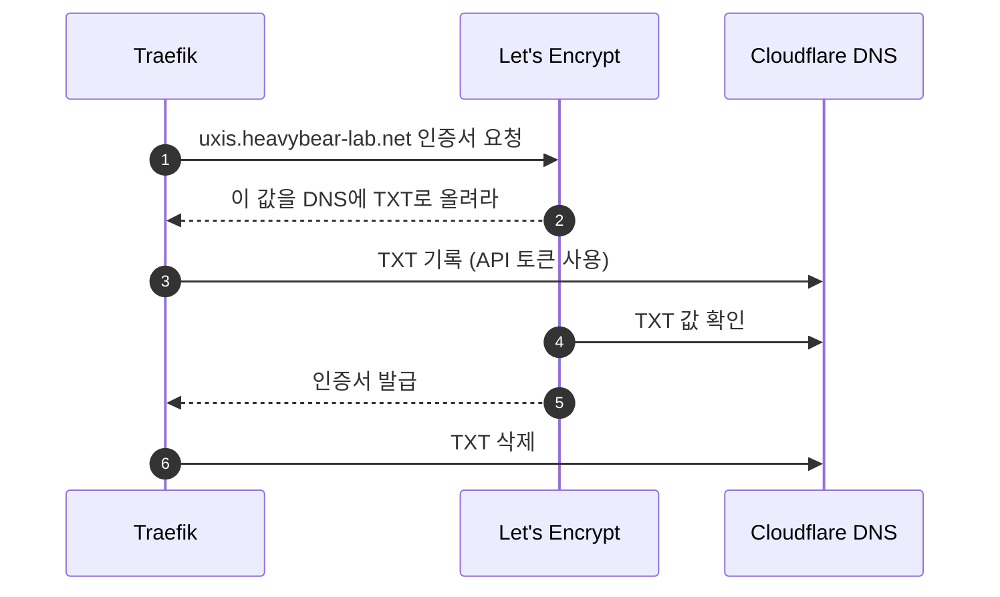

# 사내 Seafile 서버 HTTPS

사설 IP(`192.168.1.240`) 서버에 공인 인증서로 HTTPS를 적용했다. 공개 도메인 이름이 사설 IP를 가리키게 하고, Let's Encrypt 인증서를 DNS 인증으로 받는다. PC에는 아무것도 설치하지 않는다.

## 한 일 (2026-10-30)

**평소 접속.** 이름만 인터넷 DNS에서 찾고, 실제 접속은 사내 네트워크 안에서만 오간다.



**인증서 발급.** Traefik이 만료 30일 전에 자동으로 한다. Let's Encrypt는 서버에 접속하지 않고 DNS만 확인한다.



**설정한 것.**

1. **DNS:** Cloudflare `heavybear-lab.net`에 A 레코드 `uxis` → `192.168.1.240`을 추가했다. 프록시는 끄고 **DNS only**로 뒀다.
2. **Cloudflare 토큰:** Edit zone DNS 템플릿으로 만들었다. `heavybear-lab.net` 영역만 다룰 수 있고, 회사 공인 IP에서만 쓸 수 있다.
3. **Traefik(Dokploy):**
   - **Traefik File System** → `traefik.yml`의 `certificatesResolvers:` 아래에 추가했다.
     ```yaml
       letsencrypt-dns:
         acme:
           email: <관리자 메일>
           storage: /etc/dokploy/traefik/dynamic/acme-dns.json
           dnsChallenge:
             provider: cloudflare
             resolvers: ["1.1.1.1:53", "8.8.8.8:53"]
     ```
   - **Web Server** → **Traefik** → **Modify Environment**에 `CF_DNS_API_TOKEN=<토큰>`을 넣었다.
4. **Seafile 환경 변수:**
   ```
   SEAFILE_SERVER_HOSTNAME=uxis.heavybear-lab.net
   SEAFILE_SERVER_PROTOCOL=https
   SEADOC_SERVER_URL=https://uxis.heavybear-lab.net/sdoc-server
   ```
5. **Seafile compose 라벨:**
   - https 라우터(`seafile-websecure`)에 `tls.certresolver=letsencrypt-dns`와 `middlewares=seafile-cors`를 붙였다.
   - http 라우터(`seafile-web`)는 https로 넘기게 했다(`redirectscheme`).
   - SeaDoc의 `seadoc-server`와 `seadoc-socket`에도 `tls.certresolver=letsencrypt-dns`를 붙였다.
   - CORS 설정은 [dokploy-cors.md](dokploy-cors.md)에 있다.
6. **앱(v0.10.1):** [session.ts](../src/storage/session.ts)의 기본 주소(`DEFAULT`)를 새 주소로 바꿨다. 예전 주소로 저장된 사용자는 `MOVED`로 자동 전환되고, 다시 로그인할 필요는 없다.
7. **정리:** `http://192.168.1.240` 접속을 닫고, http 시절 토큰을 폐기했다.

**확인:** `curl -v https://uxis.heavybear-lab.net/api2/ping/` 결과가 인증서 오류 없이 `"pong"`이면 정상이다.

## 회사 도메인으로 바꿀 때

회사가 구매해 쓰는 인증서(예: `*.company.co.kr` 와일드카드)를 그대로 쓴다. 공인 인증서라 PC에는 여전히 설치할 것이 없다.

1. **DNS:** 회사 DNS에 A 레코드 `<새 주소>` → `192.168.1.240`을 추가한다.
2. **인증서 받기:** 회사에서 두 파일을 받는다.
   - **인증서 체인:** 서버 인증서 + 중간 인증서(PEM). 중간 인증서가 빠지면 일부 PC에서 신뢰 오류가 난다.
   - **개인 키**
   - 와일드카드는 한 단계 이름(`drive.company.co.kr`)까지만 덮는다. `a.b.company.co.kr`처럼 두 단계 이름은 덮지 못한다.
3. **Dokploy에 등록:** **Certificates** → **Add Certificate**에서 `Certificate Data`에 체인을, `Private Key`에 키를 넣고 **Create**한다. Traefik이 접속 이름에 맞는 인증서를 알아서 고른다.
4. **Seafile 설정:**
   - 환경 변수 `SEAFILE_SERVER_HOSTNAME`과 `SEADOC_SERVER_URL`을 새 주소로 바꾼다.
   - compose 라벨에서 `seafile-websecure`, `seadoc-server`, `seadoc-socket`의 `tls.certresolver=letsencrypt-dns` 줄을 지운다. `tls=true`는 남긴다.
   - Deploy한다.
5. **예전 주소 유지:** 업데이트 전의 앱이 `uxis` 주소로 접속하므로, 전환 기간에는 `uxis`용 라우터를 하나 남겨 둔다. 이 라우터는 기존처럼 `letsencrypt-dns` 인증서를 쓴다.
6. **앱 수정:** [session.ts](../src/storage/session.ts)의 `DEFAULT`를 새 주소로 바꾸고, `MOVED`에 `"https://uxis.heavybear-lab.net"`을 추가한다. 테스트를 고친 뒤 릴리스한다.
7. **정리:** 모두 업데이트하면 다음을 지운다.
   - `uxis` 라우터
   - Cloudflare의 `uxis` 레코드와 토큰
   - Traefik 환경 변수 `CF_DNS_API_TOKEN`과 `traefik.yml`의 `letsencrypt-dns` 블록

**인증서 갱신:** 자동이 아니다. 회사가 인증서를 갱신할 때마다 3번의 인증서를 새 것으로 교체(Update)한다. 공인 인증서 유효기간은 2026-03부터 최대 200일, 2027-03부터 최대 100일로 줄어들기 때문에 교체 주기도 짧아진다. 만료일은 회사 담당자와 같이 챙긴다.

**개인 키 주의:** 와일드카드 키는 회사의 모든 하위 도메인을 사칭할 수 있는 키다. 가능하면 이 서버 이름 하나만 담긴 인증서를 따로 요청한다. 키는 Dokploy에만 넣고 메신저나 저장소에 남기지 않는다.
